# Ajo Bridge

[](https://github.com/Eric-65/Ajo-Bridge/actions/workflows/ci.yml)

A rotating savings circle (ajo / esusu / susu) on NEAR where nobody can run off with the money — not the collector, and not the member who gets paid first — and anyone, anywhere can contribute from any chain via NEAR Intents.

Built Nov 13–14, 2026 for **NEAR HACKATHON — Build Beyond Boundaries**.
Track: **Real-World Money** (`realworld`). Also fits **Social Money** (`social`) and **AI Security & Defense** (`security`).

**Live demo:** https://ajo-bridge.vercel.app (no wallet needed: it opens in demo mode)

**Contents:** [What it does](#what-it-does) · [Screenshots](#screenshots) · [The problem it solves](#the-problem-it-solves) · [How to run it](#how-to-run-it) · [Try it: do X, see Y](#try-it-do-x-see-y) · [Status](#status-what-was-run-and-what-was-not) · [How it works](#how-it-works) · [NEAR tech](#near-tech-used-and-where) · [Deploy](#deploy)

## What it does

A savings circle is a group that pays into a pot every round and takes turns collecting it. Ajo Bridge runs that circle in a NEAR smart contract:

- **A contract holds the money, not a person.** It has no withdraw function. Money leaves only as a payout to the round's recipient, a refund of your own deposit, a debt repayment, or a fee share.
- **Early payout slots lock collateral.** To be paid in round `k` of `n` you lock what you will still owe afterwards. If you stop paying, the contract pays the group from that lock.
- **A backer can vouch.** Someone else (for example family abroad) can put up part of a member's collateral. The backer's stake is slashed first.
- **Waiting is paid.** Members who collect early pay a small order fee; members who wait longer share it.
- **Pay from any chain.** A NEAR Intents 1Click quote lets a member pay with USDC on Base, USDT on Tron, SOL and more.
- **An AI coordinator, Alajo, without access to funds.** It answers questions about the circle in English, Pidgin and Yoruba, posts reminders, and settles late rounds using a key that cannot move money.

The guarantee, which the tests prove: at 100% coverage, a member who collects the pot and walks away ends with a net loss, and every other member still receives a full pot.

## Screenshots

Phone screenshots of the app in demo mode (no wallet), from commit `739a4fc`, the build deployed at https://ajo-bridge.vercel.app.

<table>
<tr><td width="33%" valign="top">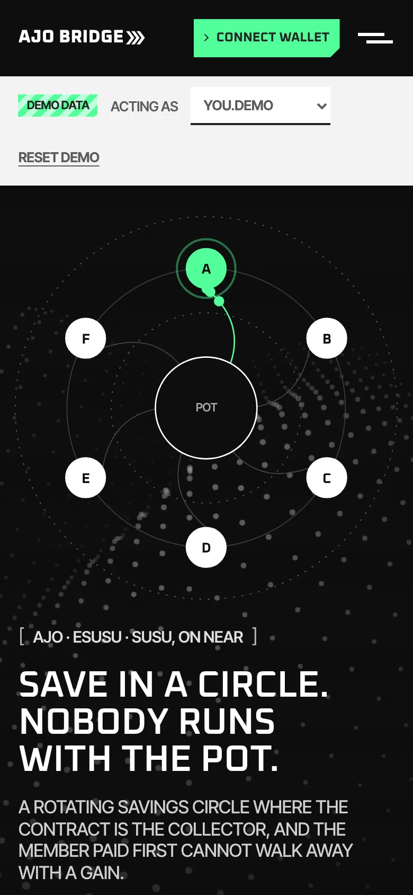<br><sub>Home: the savings ring and the promise</sub></td><td width="33%" valign="top">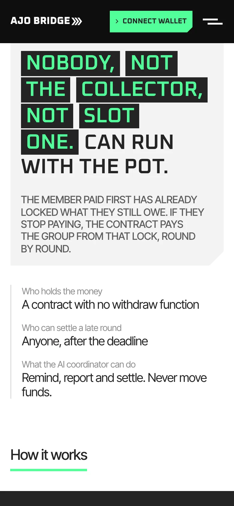<br><sub>Highlight words decode into place</sub></td><td width="33%" valign="top">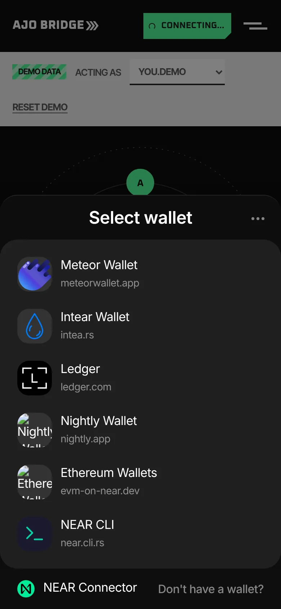<br><sub>CONNECT WALLET opens the NEAR wallet picker (Meteor first on testnet)</sub></td></tr>
<tr><td width="33%" valign="top">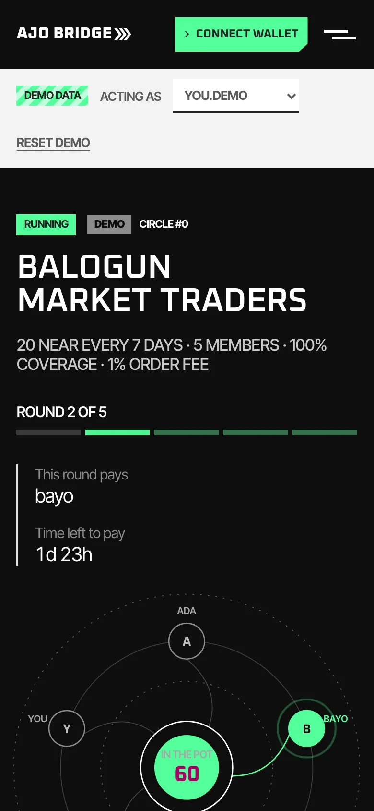<br><sub>Circle dashboard: round, recipient, countdown, pot</sub></td><td width="33%" valign="top">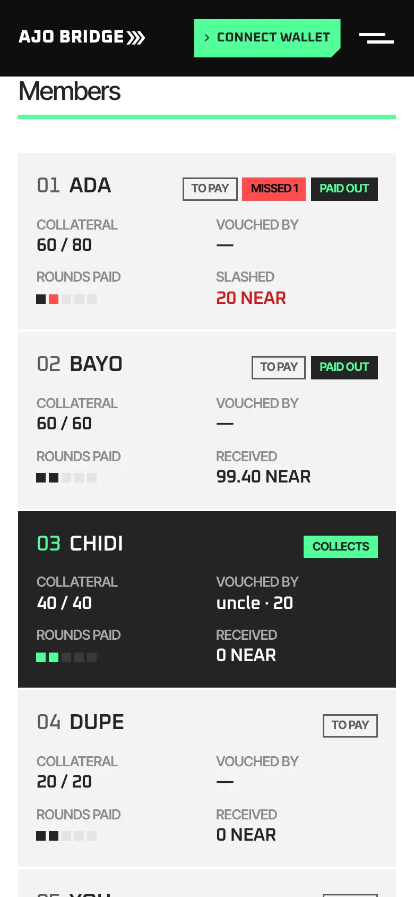<br><sub>After settling: ada is slashed 20 NEAR and marked MISSED</sub></td><td width="33%" valign="top">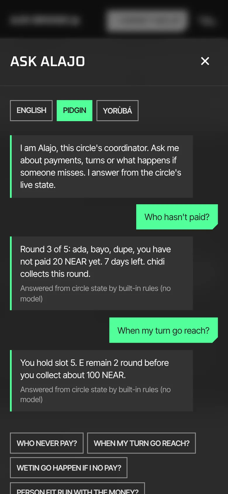<br><sub>Alajo answers from live circle state, here in Pidgin</sub></td></tr>
<tr><td width="33%" valign="top">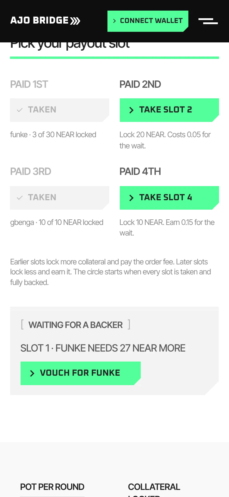<br><sub>Slot picker: taken slots in grey, open slots show the collateral</sub></td><td width="33%" valign="top">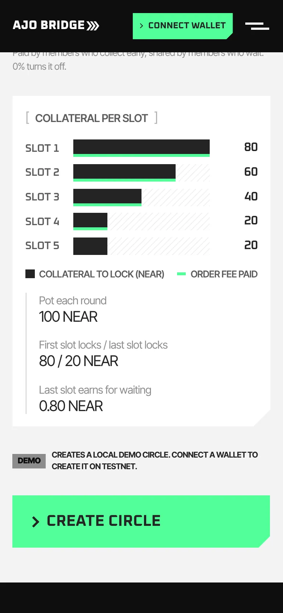<br><sub>Start a circle: collateral per slot updates live</sub></td><td width="33%" valign="top">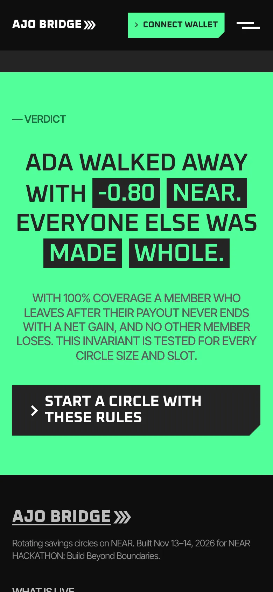<br><sub>Walk-away test verdict: the walker ends at −0.80 NEAR</sub></td></tr>
</table>

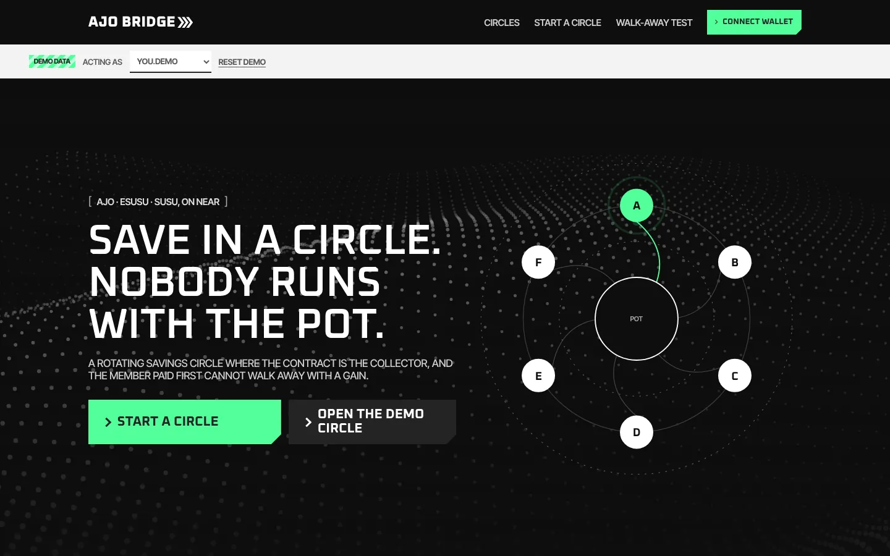 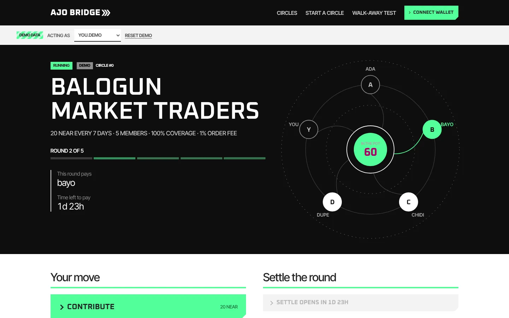

## The problem it solves

- **Collectors disappear with the pot.** In a traditional ajo one person (the *alajo*) holds everyone's money.
- **Early recipients stop paying.** The classic ROSCA failure: a member collects their payout early, then stops contributing. A flat deposit covers one missed payment, not the whole remaining debt.
- **The payout order is a hidden loan.** Early slots get interest-free credit; late slots fund it and earn nothing.
- **Diaspora members cannot easily pay in.** People hold USDC on Base or Solana, or USDT on Tron — not one token on one chain.

## How to run it

Requires Node.js 22 or newer. The contract tests need Linux or macOS (near-sdk-js does not build on Windows; use WSL). No wallet, key or account is needed for anything in this section.

| Goal | Command | Time |
| --- | --- | --- |
| See the guarantee in a terminal, no install | `npm run demo` | 1 second |
| Run the unit tests, no install | `npm run test:math` | 2 seconds |
| Run the web app in demo mode | `cd web && npm install && npm run dev`, then open `http://localhost:5173` | 1 minute |
| Install everything (contract toolchain, web, agent) | `npm run setup` | 2–3 minutes |
| Run the contract tests on a local NEAR sandbox | `npm run test:contract` (after `npm run setup`) | about 5 minutes |
| Run every test | `npm test` (after `npm run setup`) | about 5 minutes |

The web app starts in **demo mode**: seeded circles run in the browser on the same rules code the contract uses, so every screen works offline. Deploying your own contract and connecting a wallet is covered in [Deploy](#deploy).

## Try it: do X, see Y

Each row is one action and what you should see. Button names are written as they appear on screen.

### A. Terminal, no install

| # | Do | See |
| --- | --- | --- |
| 1 | Run `npm run test:math` | `# pass 43` and `# fail 0`. Includes the walk-away invariant for every circle size from 2 to 8 and every slot, plus 5,000 random default patterns. |
| 2 | Run `npm run demo` | A round-by-round replay of 5 members at 20 NEAR. Ends with `✓ INVARIANT HOLDS: walking away earned nothing and every other member was made whole.` The ledger row for `ada` (who walked) shows net `-0.80`. |
| 3 | Run `node scripts/demo.js --coverage 5000` | `✗ The group was left short.` `ada` has net `+39.20` and two members are `left short 20.00`. This is why strangers should use 100% coverage. |
| 4 | Run `node scripts/demo.js --vouch 40` | `uncle.london` is slashed for the first two missed rounds before `ada`'s own collateral is touched. |

### B. Web app in demo mode

Open https://ajo-bridge.vercel.app, or run it locally with `cd web && npm install && npm run dev` and open `http://localhost:5173`. If you have used it before, press **Reset demo** in the grey banner first.

| # | Do | See |
| --- | --- | --- |
| 5 | Open the home page | A mint **› CONNECT WALLET** button in the header and a striped **DEMO DATA** badge. In the ring, coins travel from six members into the pot, then the pot flows to one member; the recipient changes each loop. On scroll, the green-on-black words in **The promise** decode into place. |
| 6 | Open **Circles**, then **Balogun Market Traders** | Round 2 of 5. The pot shows 60. `bayo` is marked **COLLECTS**. `ada` is marked **TO PAY** and **PAID OUT**: she was paid in round 1 and has not paid round 2. You are acting as `you.demo`, slot 5. |
| 7 | Press **› CONTRIBUTE** | A mint coin travels into the pot, the pot shows 80, and the button becomes **✓ PAID FOR ROUND 2**. |
| 8 | Press **Demo only: skip to the deadline**, then **› SETTLE ROUND NOW** | A red flash: `ada` is slashed 20 NEAR and gains a **MISSED 1** tag. A message reads `Round paid: 99.40 NEAR to bayo.` The page moves to round 3 of 5. |
| 9 | Press **› ASK ALAJO**, then **Who hasn't paid?** | An answer naming the members who still owe round 3 and who collects. Tap **Pidgin** or **Yorùbá** and ask again to get the answer in that language. Each answer is labelled with its source (built-in rules, or NEAR AI Cloud when a key is configured). |
| 10 | Close the drawer. Open **Circles**, then **Lagos to London Family**. Press **› TAKE SLOT 2**, then **› LOCK 20 NEAR** | Slot 2 turns grey and reads **✓ YOURS**. A card shows that `funke` (slot 1) still needs 27 NEAR of collateral. |
| 11 | In the grey banner set **Acting as** to `uncle.london`. Press **› VOUCH FOR FUNKE**, then **› VOUCH 27 NEAR** | The message `You are backing funke.` Funke's row shows `30 / 30` collateral, vouched by `uncle`. |
| 12 | Set **Acting as** to `ada.demo`. Press **› TAKE SLOT 4**, then **› LOCK 10 NEAR** | All four slots are now taken and backed, so the circle starts by itself: the tag changes to **RUNNING** and the page shows round 1 of 4. |
| 13 | Open **Walk-away test** and press **› AUTO-PLAY** (or step with the mint button) | Five rounds play. From round 2, `ada`'s red collateral bar shrinks by 20 each round while every recipient is still paid in full. The verdict reads `ADA WALKED AWAY WITH -0.80 NEAR. EVERYONE ELSE WAS MADE WHOLE.` |
| 14 | On the same page choose **Friends · 50%** and play again | The verdict changes to `ADA GAINED +39.20. THE GROUP IS SHORT 40 NEAR.` |
| 15 | Open **Start a circle**. Switch between **Strangers · 100%** and **Friends · 50%**, and move the order-fee slider | The collateral bars animate: 80 / 60 / 40 / 20 / 20 for strangers, 40 / 30 / 20 / 20 / 20 for friends. |
| 16 | Type a name and press **› CREATE CIRCLE** | You land on the new circle's page with the tag **FILLING: PICK A SLOT** and five open slots. |
| 17 | On a running circle press **› PAY FROM ANY CHAIN** | A drawer with **MAINNET** and **TESTNET** labels. If the 1Click API is reachable you see a live quote for USDC on Base; if not, the drawer says quotes are unavailable. It never shows a made-up quote. |
| 18 | Tap **› CONNECT WALLET** in the header | The wallet picker opens with **Meteor Wallet** first, then other testnet wallets. After you connect, the button turns into your account name with a mint dot; tap it to see the network and **Disconnect**. Until the testnet contract is deployed, circles stay on demo data and the banner says so. |

### Live on NEAR testnet (real wallet, real transactions)

You need [Meteor Wallet](https://meteorwallet.app) (Android, iOS, web or Chrome extension) switched to **testnet**. Testnet NEAR is free and has no value.

| # | Do | See |
| --- | --- | --- |
| L1 | Open https://ajo-bridge.vercel.app | A **LIVE · NEAR TESTNET** bar and a mint dot in the header. The totals (circles, members, NEAR locked, rounds paid) are read from `ajobridge-circles.testnet`. No wallet needed to look around |
| L2 | In Meteor, switch the network to testnet, create a `.testnet` account, and get free testnet NEAR from a faucet such as [near-faucet.io](https://near-faucet.io) | A testnet balance of a few NEAR |
| L3 | Tap **› CONNECT WALLET** and pick Meteor | The button turns into your account name. If you connect a mainnet account or an empty one, a panel explains how to switch and where to get testnet NEAR |
| L4 | Open **Circles → Open**, then **Lagos to London Family** (circle #3, https://ajo-bridge.vercel.app/c/3) | A seeded circle with open slots. Taken slots show **✓ TAKEN**; open ones show **› TAKE SLOT k** and the collateral |
| L5 | Tap an open slot, then **› LOCK … NEAR**, and approve in Meteor | A "Confirmed on NEAR testnet" message with **View transaction**. Your name appears on the ring and in the member list, with your collateral locked |
| L6 | Open **My circles** | That circle with your payout round and collateral |
| L7 | Open **Balogun Market Traders** (circle #4) | Round 1 of 3 with two members paid and one to pay, and a countdown to the deadline |
| L8 | Open **Quick Settle Demo** (circle #5) and, once its 60-second deadline has passed, tap **› SETTLE ROUND NOW** and approve | Anyone can settle: the member who did not pay is slashed and the round's recipient is paid, in one transaction you can open on the explorer |
| L9 | On any circle tap **Share on WhatsApp** | WhatsApp opens with the circle name, contribution, open slots and an invite link (`/c/<id>`) that lands on the slot picker |

### Real testnet transactions

Signed against `ajobridge-circles.testnet` on Nov 14, 2026 by `scripts/seed-testnet.js` (Actions → **Seed testnet circles**, run 43637549360), using three throwaway faucet accounts whose keys were wiped after the run. These are the same calls, with the same deposits, that the web app sends through the wallet.

| Method | What happened | Transaction |
| --- | --- | --- |
| `create_circle` | Lagos to London Family (#3) | [G7Mnhavo9U…](https://testnet.nearblocks.io/txns/G7Mnhavo9U6wrsyEe3NNbmCmKU6TnoGxJquhM73wZVkG) |
| `join` | slot 1 with a 10% reserve | [REd81wkDNC…](https://testnet.nearblocks.io/txns/REd81wkDNC3ewDinBUMuTrSXGiwyauxddz3kobCRiUR) |
| `vouch` | a backer fills the rest of slot 1 | [HLcYmrGKCb…](https://testnet.nearblocks.io/txns/HLcYmrGKCbuVuwvhkZNdhFnsYCdexZFqVqZdmoNjt5Xm) |
| `join` | slot 4 | [DgjFjywECD…](https://testnet.nearblocks.io/txns/DgjFjywECDX3ugpwysPZt5vC7yoePyjyhyzF16ZB3UnW) |
| `leave` | before the start: full refund | [13WiVA8evw…](https://testnet.nearblocks.io/txns/13WiVA8evwQoHyvemKCdSM3QRSdkzpUzn915K5rbkn4Z) |
| `create_circle` | Balogun Market Traders (#4) | [2EWTrFKCE7…](https://testnet.nearblocks.io/txns/2EWTrFKCE7rY3eSYizPZ3idbB3HoUtpMmTG5JHsLMzhP) |
| `join` | slot 1 | [9AU95yTf2A…](https://testnet.nearblocks.io/txns/9AU95yTf2A7ks7LEDFeV8zmd1tk2xAS1cNykPqQvyCGk) |
| `join` | slot 2 | [DRiXXHxuPG…](https://testnet.nearblocks.io/txns/DRiXXHxuPGUgrDKQdBXa1Qwbg1rDinKdfuXkh3mNJ1yZ) |
| `join` | slot 3: the circle starts | [J6oapL29a5…](https://testnet.nearblocks.io/txns/J6oapL29a5dfuv8D2g5woDbFAofAuxXGt3MuhWdVCgTX) |
| `contribute` | round 1 | [HS9nHLrLNH…](https://testnet.nearblocks.io/txns/HS9nHLrLNHdDUrwmHoCc2bkMVdSpwMtWAPLLZkJ1LJ2B) |
| `contribute` | round 1 | [F14i1zY6eq…](https://testnet.nearblocks.io/txns/F14i1zY6eqhwUf36x9wVf8WojC8ThSitounECFUDPVJ9) |
| `create_circle` | Quick Settle Demo (#5) | [7h5yhUwgXJ…](https://testnet.nearblocks.io/txns/7h5yhUwgXJHZ8jiezKjKR5LVD7Ugeqea5MbzbJd4BdXS) |
| `join` | slot 1 | [DJqSaDzd1T…](https://testnet.nearblocks.io/txns/DJqSaDzd1Ti5UbEQD2Q5AsoDETPuSCcFTwYzgpidyeJM) |
| `join` | slot 2: the circle starts | [K4Mv1dzGxn…](https://testnet.nearblocks.io/txns/K4Mv1dzGxnTZGuyhTay4Nqr5CpgstJaVazK7PtMVVww) |
| `contribute` | round 1 (the other member does not pay) | [J9A4AT6T9H…](https://testnet.nearblocks.io/txns/J9A4AT6T9HiPvxsopHq6876iro2ToXakznjmEWR3gkVN) |
| `settle_round` | after the deadline, by a third account: the non-payer is slashed 0.5 NEAR, the recipient is paid | [Hn7EPVegPw…](https://testnet.nearblocks.io/txns/Hn7EPVegPwoBNWTKiy6mX3J5yPD235izUiZsDd9Xy6Qr) |

**Not yet run end to end:** the same flows signed through Meteor Wallet in the browser. The app code for it is in place (`web/src/lib/chain.js`); try steps L3–L8 above. An earlier seeding run was slowed by a rate-limited RPC and also created circles #0–#2 with the same names; they are real but duplicates.

### Community and invite links

Needs the Firebase project described in [docs/community-setup.md](docs/community-setup.md); until it is configured the page says "being set up". To try it without one, run it on the emulators (same doc, last section).

| # | Do | See |
| --- | --- | --- |
| P1 | Open **Community** in the header | A header with the live count `N people have joined`, a **Join the community** button, and a wall of the members who chose to show their profile |
| P2 | Press **Join the community**, then **Continue with Google** (or create an account with name, email and password) | You land back on Community with your name, **You invited 0**, and a personal invite link `https://ajo-bridge.vercel.app/r/<code>` with **Copy**, **Share on WhatsApp** and **Share on X** |
| P3 | Open your invite link in a private window | The sign-in page says **You were invited**. Create an account there |
| P4 | Reload Community in the first window | **You invited 1**, and the header count is one higher. The home page strip says the same total |
| P5 | Switch on **Show me in the community** | Your Google name and photo (or your name and initial for email accounts) appear on the wall. Your email never does. Switch it off and you disappear from the wall; you are still counted |
| P6 | Run `npm run test:community` (needs Java) | `# pass 8`: the security rules, run against the Firebase emulators with real signed-in users. Nobody can read another person's account, fake a referral, invite themselves, change their invite code, or publish someone else's profile |

### C. Contract on a local NEAR sandbox

Run `npm run setup` once first.

| # | Do | See |
| --- | --- | --- |
| 19 | Run `npm run test:contract` | `10 tests passed` after about 5 minutes. |
| 20 | Read the test names in the output | `INVARIANT on chain: slot 1 collects the pot and walks away — no gain, nobody else loses` (checked on real account balances). `the Alajo agent: notes only, with a function-call key that cannot move money` (NEAR rejects `contribute`, attached deposits and transfers signed with the agent's key). `custody: there is no way to pull money out of a circle`. `gas and storage: a full 12-member circle where nobody ever pays stays within limits` (heaviest call about 47 Tgas of the 300 Tgas limit). |
| 21 | Open the **CI** badge at the top of this page | The same three jobs (unit tests, contract sandbox tests, web build) passing on GitHub's machines. |

## Status: what was run and what was not

| Thing | State |
| --- | --- |
| Shared math + circle engine, 43 unit tests | Done, passing |
| near-sdk-js contract, 10 sandbox tests | Done, passing |
| Web app | **Live by default** (since Nov 14): reads `ajobridge-circles.testnet` with view calls, no wallet needed; signing needs a testnet wallet. Demo is opt-in (**Try the demo**) or automatic if no RPC answers |
| Pay-from-any-chain (1Click proxy + drawer) | **Quotes verified live** (Actions → Live checks): mainnet `dry` quotes for $20 of USDC on Base and SOL, $120 of USDT on Tron (1Click has a $100 minimum on that route), and the hosted `/api/tokens` proxy. **Not tested:** a real deposit (`dry: false`) and the status tracker after a deposit |
| Alajo (`/api/alajo`, `agent/alajo.js`) | **Verified live:** the hosted `/api/alajo` answers from circle state with the built-in English/Pidgin/Yoruba templates. **Not tested:** NEAR AI Cloud phrasing (no API key configured), and the agent script against testnet. On the deployed contract the agent is the locked contract itself, so `post_note` cannot be called there |
| Community sign-in and invite links (`/community`, `/r/<code>`) | **Built and tested on the Firebase emulators:** Google and email sign-in, invite links, referral counts, opt-in profile wall; 8 security-rule tests in CI. **Needs** a Firebase project and four Vercel variables before it works on the hosted site ([setup](docs/community-setup.md)) |
| Continuous integration | GitHub Actions runs the math, contract sandbox and web build jobs on every push |
| Testnet deployment | **Deployed:** [`ajobridge-circles.testnet`](https://testnet.nearblocks.io/address/ajobridge-circles.testnet), by Actions → Deploy contract to testnet. Initialised, checked with `get_config`, and **locked**: its only full-access key was deleted, so nobody can change its code |
| Hosted site | https://ajo-bridge.vercel.app — opens in LIVE mode on NEAR testnet. **Live checks** opens it in a real browser and confirms it lists circles from the chain |

The build environment had no access to NEAR testnet, the 1Click API, NEAR AI Cloud or Vercel, so everything that needs those is written from the official docs and marked above. Everything else was run and verified.

## What is real and what is simulated

| Part | Network | Real or simulated |
| --- | --- | --- |
| Circle rules (`shared/ajoEngine.js`) | — | Real code, shared by contract, tests and UI |
| Contract | NEAR **testnet** | Real contract at `ajobridge-circles.testnet` (code locked); also verified on the local NEAR sandbox |
| Web app (default) | NEAR **testnet** | **Real.** Circles, members, pots, history and totals are read from the contract; signing with a testnet wallet sends real transactions |
| Web app after **Try the demo** (striped **DEMO** label) | none | Simulated: seeded circles run locally on the same engine; the demo clock can be skipped. Only used when you choose it, or when no RPC answers (a banner says so) |
| Pay-from-any-chain quotes and deposits | **mainnet** (NEAR Intents 1Click) | Real quotes and real funds when the API is reachable. Never mocked: if the API is down the drawer says so |
| What a 1Click payment does | **mainnet** | Delivers wNEAR to the payer's mainnet account. It does **not** pay the testnet round automatically |
| Alajo answers | — | From real circle state. Phrased by NEAR AI Cloud when `NEAR_AI_API_KEY` is set; otherwise by built-in templates, labelled as such |
| Alajo settling rounds / posting notes | NEAR **testnet** | Real transactions with a function-call key (needs the deployed contract) |
| Community count, invite counts and profile wall | Firebase (Google) | **Real** sign-ups only. Nothing is seeded; the count starts at the number of people who actually signed up. Profiles appear only for members who switch them on |
| Imagery | — | Six stock photographs from Pixabay and one crowd photograph (Community header) supplied by the project owner, used as mood images only. The people shown are not users of Ajo Bridge. The hero's dot field is drawn in the browser |

## How it works

`n` members, contribution `C` per round, one payout per round. The member in slot `k` is paid in round `k`.

| Rule | Formula | Effect |
| --- | --- | --- |
| Slot-priced collateral | `R_k = (n − k) × C`, `S_k = max(C, R_k × coverageBps / 10000)` | Taking an early slot means locking what you will still owe after you are paid. |
| Vouching | anyone fills the part of `S_k` a member has not locked (the member keeps at least 10% at stake) | "Diaspora backs, home borrows." The voucher's stake is slashed first. |
| Fair order fee | `F_k = R_k × orderFeeBps / 10000`, shared by weight `j − 1` for slot `j` | The longer you wait for your payout, the more you earn. |
| Settlement | after the deadline anyone calls `settle_round`; each missed `C` is taken from collateral | The round's recipient is paid even if somebody stops paying. |
| No custodian | there is no withdraw method | Money only leaves as a payout, a refund of your own deposit, a debt repayment or a fee share. |

### Worked example: `n = 5`, `C = 20`, coverage 100%, order fee 1%

| Slot `k` | Owes after payout `R_k` | Collateral `S_k` | Order fee `F_k` | Fee share | Net if honest |
| --- | --- | --- | --- | --- | --- |
| 1 | 80 | 80 | 0.80 | 0.00 | −0.80 |
| 2 | 60 | 60 | 0.60 | 0.20 | −0.40 |
| 3 | 40 | 40 | 0.40 | 0.40 | 0.00 |
| 4 | 20 | 20 | 0.20 | 0.60 | +0.40 |
| 5 | 0 | 20 | 0.00 | 0.80 | +0.80 |

If the slot-1 member collects 99.20 and walks away, their 80 collateral pays their four remaining contributions. Their net is `99.20 − 20 − 80 = −0.80`: walking away gains nothing, and every other member receives a full pot.

### Rules added to make the guarantee hold

Fuzzing the engine with random default patterns showed the headline formulas alone are not enough. These rules close the gaps:

1. **Payout top-up.** Before a recipient is paid, their collateral is refilled from their own payout up to `R_k × coverageBps / 10000`. Otherwise a member could miss early rounds to burn their collateral down, then collect the pot and leave.
2. **Own-round netting.** A recipient who skips their contribution in their own payout round is not slashed; the amount is netted out of the payout.
3. **Defaulters forfeit their fee share.** A member who misses any payment loses their share of the fee pool. Forfeited fees first repay anyone who was left short, then go to the members who never missed.
4. **Debt first.** A member who owes the group receives nothing until their creditors are repaid.
5. **A vouch only fills the gap.** It never displaces the member's own stake, so nobody can push a member out of their collateral and then cancel.

**Invariant (tested):** with `coverageBps = 10000`, a member who walks away after their payout never ends up with a net gain, and no other member is worse off than in a circle where everybody paid.

With a voucher, the *voucher* takes the loss in the walker's place — that is what vouching means — so the tested statement is that the walker and their vouchers together never gain. With coverage below 100% ("friends" mode) the group can be left short; the simulator shows by exactly how much.

## NEAR tech used, and where

| NEAR technology | Where | What for |
| --- | --- | --- |
| **near-sdk-js** contract | `contract/src/contract.js` | Circles, collateral, slashing, payouts. Native NEAR, BigInt amounts, NEP-297 events |
| **NEAR Intents 1Click API** | `api/_oneclick.js`, `api/quote.js`, `api/status.js`, `api/tokens.js`, `web/src/components/PayDrawer.jsx` | Pay from USDC on Base, USDT on Tron, SOL and more; deposit address, QR, status tracking |
| **Function-call access keys** | `agent/setup-key.sh`, `contract/tests/agent.ava.js` | The agent can only call `settle_round`, `post_note`, `finalize` with zero deposit |
| **NEAR AI Cloud** (OpenAI-compatible) | `api/alajo.js`, `agent/alajo.js` | Phrases reminders, reports and answers in English, Pidgin and Yoruba |
| **Named sub-accounts** | `contract/scripts/deploy.sh` | `ajobridge.<you>.testnet` (contract), `alajo.<you>.testnet` (agent) |
| **NEP-297 events** | every change method | `EVENT_JSON` logs: the web app's ring animates from them |
| **near-workspaces sandbox** | `contract/tests/*.ava.js` | Time travel past deadlines, real balances, real access keys |
| **near-connect wallet connector** | `web/src/lib/chain.js`, header **CONNECT WALLET** button | Meteor Wallet (Android, iOS, web, Chrome extension) and other testnet wallets. NEAR Mobile is mainnet-only in the connector, so it is not offered for the testnet contract |

## Architecture


`shared/ajoEngine.js` is the single implementation of the rules. Each function takes a circle plus explicit inputs (who, how much, what time) and returns `{ transfers, events }`. The contract performs those transfers on chain; the tests and the demo mode tally them locally.

## The contract

`contract/src/contract.js` (near-sdk-js, native NEAR). Each method reads the caller, the attached deposit and the block time, runs the engine, saves the circle, then performs the transfers and logs the events the engine returned.

| Method | Who | Deposit | What it does |
| --- | --- | --- | --- |
| `create_circle` | anyone | storage fee | Sets members, contribution, round length, coverage, order fee. |
| `join({circle_id, slot})` | anyone | collateral | Takes an open slot. At least 10% of `S_k` must be the member's own; excess is refunded. Calling it again on your own slot adds collateral. |
| `vouch({circle_id, member})` | anyone | vouch amount | Fills the part of `S_k` the member has not put up. |
| `cancel_vouch`, `leave` | voucher / member | none | Before the start only. Full refund. |
| `contribute({circle_id})` | members | `C` | Pays the round. The last payment pays the recipient in the same transaction. |
| `settle_round({circle_id})` | anyone, after the deadline | none | Slashes missed contributions, pays the recipient. |
| `finalize({circle_id})` | anyone, after the last round | none | Refunds collateral, shares the fee pool. |
| `post_note({circle_id, text})` | the agent only | none | Attaches a reminder or report (max 280 characters). Moves no money. |
| `set_agent({agent})` | the owner only | none | Changes which account is the agent. This is the owner's only power. |
| views | — | — | `get_circle`, `get_member`, `quote_slot`, `list_circles`, `get_config`, `storage_fee` |

Limits: 2–12 members, order fee up to 20%, rounds from 30 seconds to 366 days, up to 4 vouchers per member.

Events (NEP-297, `standard: "ajo_bridge"`, `version: "1.0.0"`): `circle_created`, `member_joined`, `stake_added`, `vouched`, `vouch_cancelled`, `member_left`, `circle_started`, `contributed`, `contribution_netted`, `voucher_slashed`, `member_slashed`, `round_paid`, `round_started`, `rounds_complete`, `circle_completed`, `note_posted`, `agent_changed`.

### Why nobody can run with the pot

- **No withdraw path.** The contract has no method that takes an amount or a destination. NEAR leaves only through the engine's transfer list.
- **The agent cannot touch funds.** It signs with a function-call access key limited to `settle_round`, `post_note` and `finalize` on this contract. NEAR itself refuses to let such a key attach a deposit, send a transfer or call any other method — `contract/tests/agent.ava.js` proves each refusal on the sandbox. `finalize` is on the list so the agent can close a finished circle; like `settle_round` it takes no amount and no destination.
- **The owner can only change the agent.**

## Alajo, the AI coordinator

In a traditional ajo the alajo holds the money. Here Alajo only coordinates:

- **Answers** "who hasn't paid?", "when is my turn?", "what happens if I miss?" from live circle state (`/api/alajo`, the drawer on the circle page).
- **Reminds and reports**: posts a reminder once a round is half over, and a round report after each settlement (`agent/alajo.js tick`).
- **Settles** rounds whose deadline has passed and **closes** finished circles.

Every number is computed from contract state by `shared/alajo.js` before any model is involved. The model is asked only to phrase those facts, with a system prompt that forbids inventing amounts. Without a model key the built-in English, Pidgin and Yoruba templates answer instead, and the UI labels which one you got. The Pidgin and Yoruba templates are short and should be reviewed by a native speaker.

```bash
node agent/alajo.js status 0 --lang pcm          # what is going on in circle 0
node agent/alajo.js ask 0 "Who hasn't paid?"     # answer one question
node agent/alajo.js tick --dry-run               # show what a pass would do, sign nothing
node agent/alajo.js watch --interval 60          # keep coordinating
```

## Deploy

**Easiest: from GitHub, no computer or keys needed.** Open **Actions → Deploy contract to testnet → Run workflow**. It creates a fresh account with NEAR's testnet faucet, deploys and initialises the contract, checks it with a view call, and by default deletes the account's only full-access key, so nobody can change the contract's code afterwards. The run summary shows the contract ID; put it in Vercel as `VITE_AJO_CONTRACT_ID` and redeploy. Script: `contract/scripts/deploy-testnet-ci.sh`.

**Or from your own machine** with near-cli-rs:

```bash
cp .env.example .env                       # then fill in as you go
npm run setup && npm run build:contract

# 1. Contract + agent account on testnet (near-cli-rs, logged in to you.testnet)
PARENT=you.testnet ./contract/scripts/deploy.sh

# 2. The agent's restricted key (prints the key pair once; put the private key in .env)
ALAJO_ACCOUNT_ID=alajo.you.testnet AJO_CONTRACT_ID=ajobridge.you.testnet ./agent/setup-key.sh

# 3. Web + API on Vercel. Root Directory = repository root (blank); vercel.json sets install and build.
#    Environment variables: VITE_AJO_CONTRACT_ID (read at build time: redeploy after setting it),
#    NEAR_AI_API_KEY (optional), ONECLICK_JWT (optional)
vercel --prod

# 4. Check every live dependency from your machine (1Click, testnet contract, NEAR AI Cloud, the site)
SMOKE_URL=https://your-app.vercel.app npm run smoke
```

`npm run smoke` talks only to real services and exits non-zero if anything fails. `vercel build` was run locally on a fresh copy of the repository: it produces the static site plus four functions (`alajo`, `quote`, `status`, `tokens`).

Live URL: https://ajo-bridge.vercel.app. Deployed contract: [`ajobridge-circles.testnet`](https://testnet.nearblocks.io/address/ajobridge-circles.testnet) (no access keys: code cannot be changed).

## Hackathon rules (answers to the HACKATHON.md FAQ)

| Question | Answer for this project |
| --- | --- |
| When was it built? (Q-001) | Nov 13–14, 2026, inside the hackathon window. The first commit in this repository is the start of the project. |
| Existing product or earlier code? (Q-002–Q-004) | None. New repository, new project, no pre-hackathon baseline. |
| Libraries, templates, AI code? (Q-005) | Listed under [Credits](#credits) and [AI tools disclosure](#ai-tools-disclosure). No project template was used. |
| Why does pay-from-any-chain use mainnet? (Q-007) | NEAR Intents has no testnet. The drawer previews with `dry: true` quotes and labels every mainnet step. |
| Testnet-only contract? (Q-010) | Yes, the circle contract targets testnet. Only the 1Click integration is mainnet, because it is mainnet-only. |
| Can judges run it without a hosted demo? (Q-012) | Yes: `npm run test:math`, `npm run demo` and `npm run dev` (demo mode) need no keys and no network. |
| License (Q-014) | MIT, see [LICENSE](LICENSE). |

## From hackathon to small business

A roadmap, not shipped code.

1. **Stablecoin circles.** Contributions and collateral in USDC (a NEP-141 token) instead of native NEAR, so savings do not swing with the NEAR price.
2. **Cross-chain payments that credit the round.** Today a 1Click payment lands in the payer's own NEAR account. Next: the 1Click deposit lands in the contract and credits that member's contribution for the current round.
3. **An honest organiser fee.** An operator fee (for example 1% of each payout), split between the circle's creator and the platform and enforced by the contract. The alajo's role becomes a paid, transparent job instead of a position of trust.
4. **Naira on- and off-ramps** through local partners, and identity checks for large circles.
5. **Before real money:** a security audit, a mainnet deployment, and a legal review. Pooled savings schemes are regulated in Nigeria.
6. **Pilot:** three real ajo groups (market traders, a church group, a diaspora family) running a four-week circle.

## Repository layout

```
shared/     ajoMath.js, ajoEngine.js, simulate.js, alajo.js, units.js + node:test tests
scripts/    demo.js (offline walk-away simulation), smoke.js (live checks after deploying)
tests/      API tests (kept out of api/ so Vercel does not deploy them as functions)
contract/   near-sdk-js contract, sandbox tests (near-workspaces + ava), deploy script
web/        Vite + React app
  src/styles/   tokens.css, base.css, components.css, motion.css (hand-written CSS)
  src/motion/   requestAnimationFrame / Web Animations helpers (no animation library)
firestore.rules, firebase.json   community data rules (Firebase) and emulator config
docs/       community-setup.md, screenshots
api/        serverless functions: quote, status, tokens (1Click proxy), alajo
agent/      alajo.js (coordinator), setup-key.sh (function-call key)
```

Front-end notes: no Tailwind, UI kit, CSS-in-JS or animation library. Design tokens are CSS custom properties; cut corners use `clip-path`; the CTA sweep and attention border use `@property`; cards use container queries; form and slot states use `:has()`; reveals use `animation-timeline: view()` with an IntersectionObserver fallback; routes use the View Transitions API; all motion stops under `prefers-reduced-motion`.

## Known limitations

- **Not deployed and not audited.** Testnet funds only.
- The deployed testnet contract has **no access keys**, so its code cannot be changed by anyone. The flip side: a bug fix means deploying a new contract account. Deploying with `contract/scripts/deploy.sh` instead keeps a full-access key, and for real money that key should be deleted or handed to a DAO.
- Payouts are plain NEAR transfers. If a recipient deletes their account, the transfer bounces back to the contract and stays there.
- The storage fee is a flat estimate (8,000 bytes plus 2,500 per member, about 0.2 NEAR for five members), not metered per byte.
- v1 uses native NEAR, not a stablecoin, so contributions carry NEAR price risk.
- Cross-chain payments land on mainnet while circles are on testnet; they are not linked on chain in this version.
- Members who miss a payment lose their whole fee share, even for one late round. Late payments are accepted until somebody calls `settle_round`.
- Not yet run against live services: signing through Meteor Wallet in the browser (the same contract calls were signed from a script, see *Real testnet transactions*), a real 1Click deposit (only `dry` quotes were checked), and NEAR AI Cloud (no API key configured).

## Prior art

Rotating savings and credit associations are centuries old: ajo and esusu in Nigeria, susu in Ghana and the Caribbean, chit funds in India, tandas in Mexico. The default-after-payout problem is described in the economics literature, for example Besley, Coate and Loury, "The Economics of Rotating Savings and Credit Associations" (American Economic Review, 1993) and Anderson, Baland and Moene, "Enforcement in informal saving groups" (Journal of Development Economics, 2009).

Earlier onchain ROSCAs include WeTrust's Trusted Lending Circles on Ethereum and Bloinx on Celo. Ajo Bridge differs in pricing collateral by payout slot, letting a third party vouch that collateral, and paying waiting members an order fee. All code in this repository was written from scratch for this hackathon; nothing was copied or forked from another project.

## Credits

- **Visual direction**: styled after the layout language of an editorial agency template supplied by the project owner (near-black, white and mint; squared display type; cut-corner bars). No brand names, logos, text or photographs from that template are used.
- **Photographs**: six images from [Pixabay](https://pixabay.com), used under the [Pixabay Content License](https://pixabay.com/service/license-summary/) (free for commercial and non-commercial use, no attribution required). Supplied by the project owner, converted to black and white with a vignette and grain, and resized to WebP in `web/public/img/`. They are mood images: the people shown are models and are not users of, or endorsing, Ajo Bridge. The Community header is a crowd photograph supplied by the project owner, cropped to remove signs and treated the same way; the people in it are not users of, or endorsing, Ajo Bridge.
- **Hero dot field**: drawn in the browser by `web/src/motion/halftone.js`.
- **Fonts** (SIL Open Font License, self-hosted through Fontsource): Oxanium, Inter Tight, JetBrains Mono.
- **Libraries**: near-sdk-js, near-workspaces, ava, near-api-js, @hot-labs/near-connect, React, React Router, Vite, qrcode.

## AI tools disclosure

Built with an AI coding agent (Claude Code) directed by the project owner, using the NEAR agent skills (`near/agent-skills`, pinned in `skills-lock.json`). The running product uses NEAR AI Cloud for Alajo's wording when a key is configured.

## License

MIT — see [LICENSE](LICENSE).
