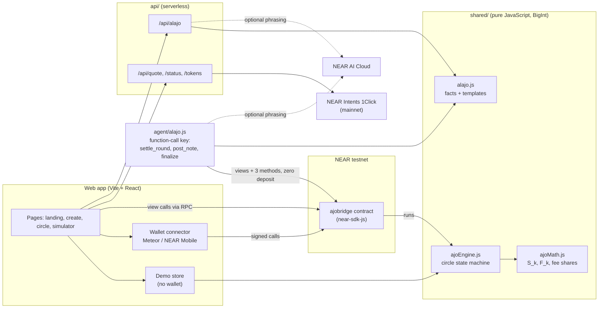

# Ajo Bridge

[](https://github.com/Eric-65/Ajo-Bridge/actions/workflows/ci.yml)

A rotating savings circle (ajo / esusu / susu) on NEAR where nobody can run off with the money — not the collector, and not the member who gets paid first — and anyone, anywhere can contribute from any chain via NEAR Intents.

Built Nov 13–14, 2026 for **NEAR HACKATHON — Build Beyond Boundaries**.
Track: **Real-World Money** (`realworld`). Also fits **Social Money** (`social`) and **AI Security & Defense** (`security`).

## Status at a glance

| Thing | State |
| --- | --- |
| Shared math + circle engine, 43 unit tests | Done, passing |
| near-sdk-js contract, 10 sandbox tests | Done, passing |
| Web app (demo mode: every screen works with no wallet) | Done |
| Pay-from-any-chain (1Click proxy + drawer) | Written, **not exercised against the live API** |
| Alajo agent + `/api/alajo` | Written; rule-based answers tested, **NEAR AI Cloud and testnet calls not exercised** |
| Continuous integration | GitHub Actions runs the math, contract sandbox and web build jobs on every push |
| Testnet deployment | **Not deployed yet** — no contract address. Run `contract/scripts/deploy.sh` |
| Vercel deployment | **Not deployed yet** — no live URL. See [Deploy](#deploy) |

The build environment had no access to NEAR testnet, the 1Click API, NEAR AI Cloud or Vercel, so everything that needs those is written from the official docs and marked above. Everything else was run and verified.

## The problem

- **Collectors disappear with the pot.** In a traditional ajo one person (the *alajo*) holds everyone's money.
- **Early recipients stop paying.** The classic ROSCA failure: a member collects their payout early, then stops contributing. A flat deposit covers one missed payment, not the whole remaining debt.
- **The payout order is a hidden loan.** Early slots get interest-free credit; late slots fund it and earn nothing.
- **Diaspora members cannot easily pay in.** People hold USDC on Base or Solana, or USDT on Tron — not one token on one chain.

## What it does

`n` members, contribution `C` per round, one payout per round. The member in slot `k` is paid in round `k`.

| Rule | Formula | Effect |
| --- | --- | --- |
| Slot-priced collateral | `R_k = (n − k) × C`, `S_k = max(C, R_k × coverageBps / 10000)` | Taking an early slot means locking what you will still owe after you are paid. |
| Vouching | anyone fills the part of `S_k` a member has not locked (the member keeps at least 10% at stake) | "Diaspora backs, home borrows." The voucher's stake is slashed first. |
| Fair order fee | `F_k = R_k × orderFeeBps / 10000`, shared by weight `j − 1` for slot `j` | The longer you wait for your payout, the more you earn. |
| Settlement | after the deadline anyone calls `settle_round`; each missed `C` is taken from collateral | The round's recipient is paid even if somebody stops paying. |
| No custodian | there is no withdraw method | Money only leaves as a payout, a refund of your own deposit, a debt repayment or a fee share. |

### Worked example: `n = 5`, `C = 20`, coverage 100%, order fee 1%

| Slot `k` | Owes after payout `R_k` | Collateral `S_k` | Order fee `F_k` | Fee share | Net if honest |
| --- | --- | --- | --- | --- | --- |
| 1 | 80 | 80 | 0.80 | 0.00 | −0.80 |
| 2 | 60 | 60 | 0.60 | 0.20 | −0.40 |
| 3 | 40 | 40 | 0.40 | 0.40 | 0.00 |
| 4 | 20 | 20 | 0.20 | 0.60 | +0.40 |
| 5 | 0 | 20 | 0.00 | 0.80 | +0.80 |

If the slot-1 member collects 99.20 and walks away, their 80 collateral pays their four remaining contributions. Their net is `99.20 − 20 − 80 = −0.80`: walking away gains nothing, and every other member receives a full pot.

### Rules added to make the guarantee hold

Fuzzing the engine with random default patterns showed the headline formulas alone are not enough. These rules close the gaps:

1. **Payout top-up.** Before a recipient is paid, their collateral is refilled from their own payout up to `R_k × coverageBps / 10000`. Otherwise a member could miss early rounds to burn their collateral down, then collect the pot and leave.
2. **Own-round netting.** A recipient who skips their contribution in their own payout round is not slashed; the amount is netted out of the payout.
3. **Defaulters forfeit their fee share.** A member who misses any payment loses their share of the fee pool. Forfeited fees first repay anyone who was left short, then go to the members who never missed.
4. **Debt first.** A member who owes the group receives nothing until their creditors are repaid.
5. **A vouch only fills the gap.** It never displaces the member's own stake, so nobody can push a member out of their collateral and then cancel.

**Invariant (tested):** with `coverageBps = 10000`, a member who walks away after their payout never ends up with a net gain, and no other member is worse off than in a circle where everybody paid.

With a voucher, the *voucher* takes the loss in the walker's place — that is what vouching means — so the tested statement is that the walker and their vouchers together never gain. With coverage below 100% ("friends" mode) the group can be left short; the simulator shows by exactly how much.

## Try it

Requires Node.js 22 or newer on Linux or macOS (near-sdk-js does not build on Windows; use WSL).

### A. No install — math, engine and the terminal demo

1. Run `npm run test:math` → see `# pass 43`, `# fail 0`. This includes the walk-away invariant for every `n` from 2 to 8 and every slot, plus 5,000 random default patterns.
2. Run `npm run demo` → see a round-by-round replay ending with `✓ INVARIANT HOLDS: walking away earned nothing and every other member was made whole.` and a ledger where `ada` (the walker) has net `-0.80`.
3. Run `node scripts/demo.js --coverage 5000` → see `✗ The group was left short`, the walker's net `+39.20` and two members `left short 20.00`.
4. Run `node scripts/demo.js --vouch 40` → see `uncle.london` slashed for the first two missed rounds before the walker's own collateral is touched.

Other demo options: `--n 6`, `--walker 2`, `--fee 250`, `--contribution 50`.

### B. The web app in demo mode (no wallet, no keys)

5. Run `npm run setup` once, then `npm run dev`, and open `http://localhost:5173`. → A grey status dot and a striped **DEMO DATA** badge show you are on local data.
6. On the landing page, watch the ring: coins travel from six members into the pot, then the pot flows to one member. → The recipient changes every loop.
7. Open **Circles → Balogun Market Traders**. You are acting as `you.demo` (slot 5). Press **› CONTRIBUTE**. → A mint coin travels into the pot and the pot shows 80.
8. Press **Demo only: skip to the deadline**, then **› SETTLE ROUND NOW**. → `ada`, who was already paid in round 1 and has not paid round 2, is slashed 20 NEAR (red flash), `bayo` is paid 99.40, and the page moves to round 3.
9. Press **› ASK ALAJO**, then **Who hasn't paid?** → An answer naming the members who still owe this round. Switch to **Pidgin** or **Yorùbá** and ask again.
10. Open **Circles → Lagos to London Family**. Press **› TAKE SLOT 2**, then **Lock 20 NEAR**. → The slot turns grey with **✓ YOURS**.
11. Change **Acting as** to `uncle.london` and press **› VOUCH FOR FUNKE**. → Funke's collateral is complete. Take the last slot as any other persona → the tag changes to **RUNNING**.
12. Open **Walk-away test** and keep pressing the mint button (**› START ROUND 1**, **› PLAY ROUND 2** … **› SEE THE LEDGER**), or press **› AUTO-PLAY**. → The verdict reads `ADA WALKED AWAY WITH -0.80 NEAR. EVERYONE ELSE WAS MADE WHOLE.` Switch to **Friends · 50%** and replay → the verdict turns to a gain of `+39.20` and a 40 NEAR shortfall.
13. Open **Start a circle** and move the order-fee slider or switch coverage. → The collateral bars animate to the new values.

### C. The contract on a local NEAR sandbox (about 4 minutes)

14. Run `npm run test:contract` → see `10 tests passed`, including:
    - `INVARIANT on chain: slot 1 collects the pot and walks away — no gain, nobody else loses` (checked on real account balances),
    - `the Alajo agent: notes only, with a function-call key that cannot move money` (the protocol rejects `contribute`, attached deposits and transfers signed with the agent's key),
    - `custody: there is no way to pull money out of a circle`,
    - `gas and storage: a full 12-member circle where nobody ever pays stays within limits` (heaviest call about 47 Tgas of the 300 Tgas limit).
15. Run `npm test` → runs A and C together.

## What is real and what is simulated

| Part | Network | Real or simulated |
| --- | --- | --- |
| Circle rules (`shared/ajoEngine.js`) | — | Real code, shared by contract, tests and UI |
| Contract | NEAR **testnet** | Real contract; **not deployed yet**, verified on the local NEAR sandbox |
| Web app with a wallet connected | NEAR **testnet** | Real view calls and signed transactions (needs the deployed contract) |
| Web app without a wallet (**DEMO DATA** badge) | none | Simulated: seeded circles run locally on the same engine. The demo clock can be skipped forward |
| Pay-from-any-chain quotes and deposits | **mainnet** (NEAR Intents 1Click) | Real quotes and real funds when the API is reachable. Never mocked: if the API is down the drawer says so |
| What a 1Click payment does | **mainnet** | Delivers wNEAR to the payer's mainnet account. It does **not** pay the testnet round automatically |
| Alajo answers | — | From real circle state. Phrased by NEAR AI Cloud when `NEAR_AI_API_KEY` is set; otherwise by built-in templates, labelled as such |
| Alajo settling rounds / posting notes | NEAR **testnet** | Real transactions with a function-call key (needs the deployed contract) |
| Hero imagery | — | Generated in the browser (halftone canvas). No photographs |

## NEAR tech used, and where

| NEAR technology | Where | What for |
| --- | --- | --- |
| **near-sdk-js** contract | `contract/src/contract.js` | Circles, collateral, slashing, payouts. Native NEAR, BigInt amounts, NEP-297 events |
| **NEAR Intents 1Click API** | `api/_oneclick.js`, `api/quote.js`, `api/status.js`, `api/tokens.js`, `web/src/components/PayDrawer.jsx` | Pay from USDC on Base, USDT on Tron, SOL and more; deposit address, QR, status tracking |
| **Function-call access keys** | `agent/setup-key.sh`, `contract/tests/agent.ava.js` | The agent can only call `settle_round`, `post_note`, `finalize` with zero deposit |
| **NEAR AI Cloud** (OpenAI-compatible) | `api/alajo.js`, `agent/alajo.js` | Phrases reminders, reports and answers in English, Pidgin and Yoruba |
| **Named sub-accounts** | `contract/scripts/deploy.sh` | `ajobridge.<you>.testnet` (contract), `alajo.<you>.testnet` (agent) |
| **NEP-297 events** | every change method | `EVENT_JSON` logs: the web app's ring animates from them |
| **near-workspaces sandbox** | `contract/tests/*.ava.js` | Time travel past deadlines, real balances, real access keys |
| **near-connect wallet connector** | `web/src/lib/chain.js` | Meteor Wallet, NEAR Mobile and other testnet wallets |

## Architecture



`shared/ajoEngine.js` is the single implementation of the rules. Each function takes a circle plus explicit inputs (who, how much, what time) and returns `{ transfers, events }`. The contract performs those transfers on chain; the tests and the demo mode tally them locally.

## The contract

`contract/src/contract.js` (near-sdk-js, native NEAR). Each method reads the caller, the attached deposit and the block time, runs the engine, saves the circle, then performs the transfers and logs the events the engine returned.

| Method | Who | Deposit | What it does |
| --- | --- | --- | --- |
| `create_circle` | anyone | storage fee | Sets members, contribution, round length, coverage, order fee. |
| `join({circle_id, slot})` | anyone | collateral | Takes an open slot. At least 10% of `S_k` must be the member's own; excess is refunded. Calling it again on your own slot adds collateral. |
| `vouch({circle_id, member})` | anyone | vouch amount | Fills the part of `S_k` the member has not put up. |
| `cancel_vouch`, `leave` | voucher / member | none | Before the start only. Full refund. |
| `contribute({circle_id})` | members | `C` | Pays the round. The last payment pays the recipient in the same transaction. |
| `settle_round({circle_id})` | anyone, after the deadline | none | Slashes missed contributions, pays the recipient. |
| `finalize({circle_id})` | anyone, after the last round | none | Refunds collateral, shares the fee pool. |
| `post_note({circle_id, text})` | the agent only | none | Attaches a reminder or report (max 280 characters). Moves no money. |
| `set_agent({agent})` | the owner only | none | Changes which account is the agent. This is the owner's only power. |
| views | — | — | `get_circle`, `get_member`, `quote_slot`, `list_circles`, `get_config`, `storage_fee` |

Limits: 2–12 members, order fee up to 20%, rounds from 30 seconds to 366 days, up to 4 vouchers per member.

Events (NEP-297, `standard: "ajo_bridge"`, `version: "1.0.0"`): `circle_created`, `member_joined`, `stake_added`, `vouched`, `vouch_cancelled`, `member_left`, `circle_started`, `contributed`, `contribution_netted`, `voucher_slashed`, `member_slashed`, `round_paid`, `round_started`, `rounds_complete`, `circle_completed`, `note_posted`, `agent_changed`.

### Why nobody can run with the pot

- **No withdraw path.** The contract has no method that takes an amount or a destination. NEAR leaves only through the engine's transfer list.
- **The agent cannot touch funds.** It signs with a function-call access key limited to `settle_round`, `post_note` and `finalize` on this contract. NEAR itself refuses to let such a key attach a deposit, send a transfer or call any other method — `contract/tests/agent.ava.js` proves each refusal on the sandbox. `finalize` is on the list so the agent can close a finished circle; like `settle_round` it takes no amount and no destination.
- **The owner can only change the agent.**

## Alajo, the AI coordinator

In a traditional ajo the alajo holds the money. Here Alajo only coordinates:

- **Answers** "who hasn't paid?", "when is my turn?", "what happens if I miss?" from live circle state (`/api/alajo`, the drawer on the circle page).
- **Reminds and reports**: posts a reminder once a round is half over, and a round report after each settlement (`agent/alajo.js tick`).
- **Settles** rounds whose deadline has passed and **closes** finished circles.

Every number is computed from contract state by `shared/alajo.js` before any model is involved. The model is asked only to phrase those facts, with a system prompt that forbids inventing amounts. Without a model key the built-in English, Pidgin and Yoruba templates answer instead, and the UI labels which one you got. The Pidgin and Yoruba templates are short and should be reviewed by a native speaker.

```bash
node agent/alajo.js status 0 --lang pcm          # what is going on in circle 0
node agent/alajo.js ask 0 "Who hasn't paid?"     # answer one question
node agent/alajo.js tick --dry-run               # show what a pass would do, sign nothing
node agent/alajo.js watch --interval 60          # keep coordinating
```

## Deploy

None of these steps has been run yet for this repository.

```bash
cp .env.example .env                       # then fill in as you go
npm run setup && npm run build:contract

# 1. Contract + agent account on testnet (near-cli-rs, logged in to you.testnet)
PARENT=you.testnet ./contract/scripts/deploy.sh

# 2. The agent's restricted key (prints the key pair once; put the private key in .env)
ALAJO_ACCOUNT_ID=alajo.you.testnet AJO_CONTRACT_ID=ajobridge.you.testnet ./agent/setup-key.sh

# 3. Web + API on Vercel. Root Directory = repository root (blank); vercel.json sets install and build.
#    Environment variables: VITE_AJO_CONTRACT_ID (read at build time: redeploy after setting it),
#    NEAR_AI_API_KEY (optional), ONECLICK_JWT (optional)
vercel --prod

# 4. Check every live dependency from your machine (1Click, testnet contract, NEAR AI Cloud, the site)
SMOKE_URL=https://your-app.vercel.app npm run smoke
```

`npm run smoke` talks only to real services and exits non-zero if anything fails. `vercel build` was run locally on a fresh copy of the repository: it produces the static site plus four functions (`alajo`, `quote`, `status`, `tokens`).

Deployed contract address: _not deployed yet_. Live URL: _not deployed yet_.

## Hackathon rules (answers to the HACKATHON.md FAQ)

| Question | Answer for this project |
| --- | --- |
| When was it built? (Q-001) | Nov 13–14, 2026, inside the hackathon window. The first commit in this repository is the start of the project. |
| Existing product or earlier code? (Q-002–Q-004) | None. New repository, new project, no pre-hackathon baseline. |
| Libraries, templates, AI code? (Q-005) | Listed under [Credits](#credits) and [AI tools disclosure](#ai-tools-disclosure). No project template was used. |
| Why does pay-from-any-chain use mainnet? (Q-007) | NEAR Intents has no testnet. The drawer previews with `dry: true` quotes and labels every mainnet step. |
| Testnet-only contract? (Q-010) | Yes, the circle contract targets testnet. Only the 1Click integration is mainnet, because it is mainnet-only. |
| Can judges run it without a hosted demo? (Q-012) | Yes: `npm run test:math`, `npm run demo` and `npm run dev` (demo mode) need no keys and no network. |
| License (Q-014) | MIT, see [LICENSE](LICENSE). |

## Repository layout

```
shared/     ajoMath.js, ajoEngine.js, simulate.js, alajo.js, units.js + node:test tests
scripts/    demo.js (offline walk-away simulation), smoke.js (live checks after deploying)
tests/      API tests (kept out of api/ so Vercel does not deploy them as functions)
contract/   near-sdk-js contract, sandbox tests (near-workspaces + ava), deploy script
web/        Vite + React app
  src/styles/   tokens.css, base.css, components.css, motion.css (hand-written CSS)
  src/motion/   requestAnimationFrame / Web Animations helpers (no animation library)
api/        serverless functions: quote, status, tokens (1Click proxy), alajo
agent/      alajo.js (coordinator), setup-key.sh (function-call key)
```

Front-end notes: no Tailwind, UI kit, CSS-in-JS or animation library. Design tokens are CSS custom properties; cut corners use `clip-path`; the CTA sweep and attention border use `@property`; cards use container queries; form and slot states use `:has()`; reveals use `animation-timeline: view()` with an IntersectionObserver fallback; routes use the View Transitions API; all motion stops under `prefers-reduced-motion`.

## Known limitations

- **Not deployed and not audited.** Testnet funds only.
- The contract account still has a full-access key, and whoever holds it could deploy different code. For real money that key should be deleted or handed to a DAO.
- Payouts are plain NEAR transfers. If a recipient deletes their account, the transfer bounces back to the contract and stays there.
- The storage fee is a flat estimate (8,000 bytes plus 2,500 per member, about 0.2 NEAR for five members), not metered per byte.
- v1 uses native NEAR, not a stablecoin, so contributions carry NEAR price risk.
- Cross-chain payments land on mainnet while circles are on testnet; they are not linked on chain in this version.
- Members who miss a payment lose their whole fee share, even for one late round. Late payments are accepted until somebody calls `settle_round`.
- The wallet flow and the 1Click and NEAR AI Cloud calls were written from documentation and have not been run against the live services.

## Prior art

Rotating savings and credit associations are centuries old: ajo and esusu in Nigeria, susu in Ghana and the Caribbean, chit funds in India, tandas in Mexico. The default-after-payout problem is described in the economics literature, for example Besley, Coate and Loury, "The Economics of Rotating Savings and Credit Associations" (American Economic Review, 1993) and Anderson, Baland and Moene, "Enforcement in informal saving groups" (Journal of Development Economics, 2009).

Earlier onchain ROSCAs include WeTrust's Trusted Lending Circles on Ethereum and Bloinx on Celo. Ajo Bridge differs in pricing collateral by payout slot, letting a third party vouch that collateral, and paying waiting members an order fee. All code in this repository was written from scratch for this hackathon; nothing was copied or forked from another project.

## Credits

- **Visual direction**: styled after the layout language of an editorial agency template supplied by the project owner (near-black, white and mint; squared display type; cut-corner bars). No brand names, logos, text or photographs from that template are used.
- **Images**: none. The black-and-white fields are drawn in the browser by `web/src/motion/halftone.js`.
- **Fonts** (SIL Open Font License, self-hosted through Fontsource): Oxanium, Inter Tight, JetBrains Mono.
- **Libraries**: near-sdk-js, near-workspaces, ava, near-api-js, @hot-labs/near-connect, React, React Router, Vite, qrcode.

## AI tools disclosure

Built with an AI coding agent (Claude Code) directed by the project owner, using the NEAR agent skills (`near/agent-skills`, pinned in `skills-lock.json`). The running product uses NEAR AI Cloud for Alajo's wording when a key is configured.

## License

MIT — see [LICENSE](LICENSE).
